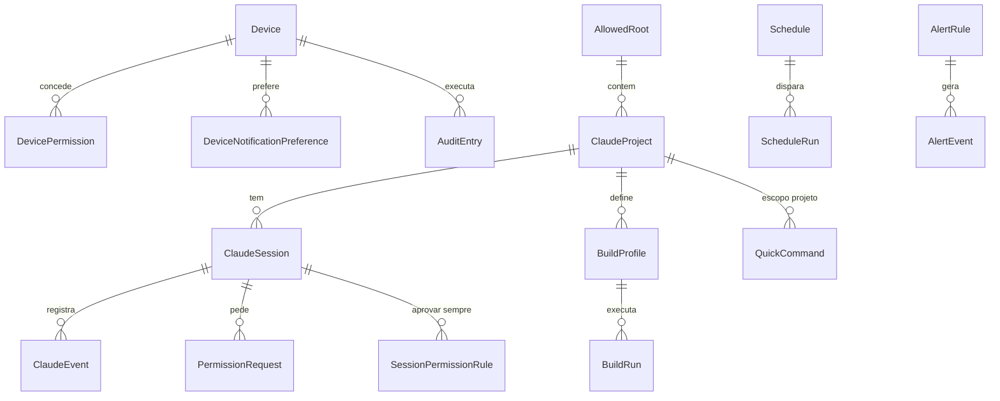

# Modelo de dados — MyRemoteControll Agent

> **Status:** Aprovado em 2026-10-18. Evolui pelas specs (mudanças passam pelo `/spec`). Base: seção 7 do documento base. ADR-0007 (SQLite + EF Core 10).
> Ajustes em relação ao documento base estão marcados com **[ajuste]** e listados na seção 5.

Convenções: chaves `Guid` (v7, ordenáveis) salvo indicação; datas `DateTimeOffset` UTC via `TimeProvider`; enums
gravados como texto; JSON em colunas `TEXT`; nomes de tabela no plural.

## 1. Diagrama

## 2. Segurança e dispositivos

### Device
| Campo | Tipo | Regras |
|---|---|---|
| Id | Guid | PK |
| Name | string(100) | Nome dado no pareamento; editável |
| Platform | enum `Android`, `iOS` | |
| Role | enum `ReadOnly`, `Operator`, `Administrator` | Primeiro aparelho = Administrator |
| TokenHash | byte[32] | HMAC-SHA256(pepper, token); índice único |
| TokenRotatedAt | DateTimeOffset | Rotação a cada 30 dias |
| PreviousTokenHash / PreviousTokenExpiresAt | byte[32]? / DateTimeOffset? | **[ajuste]** carência de 24 h na rotação |
| PushProvider / PushToken | enum `Fcm`, `Ntfy`? / string? | **[ajuste]** o documento base só tinha `PushToken` |
| CreatedAt / LastSeenAt / RevokedAt | DateTimeOffset / ? / ? | Revogação lógica e imediata |

**[ajuste]** `IsReadOnly` removido: é o mesmo que `Role = ReadOnly`.

### DevicePermission
PK composta (`DeviceId`, `PermissionKey`). Permissões extras além das do papel (ADR-0009).

### DeviceNotificationPreference **[novo]**
PK composta (`DeviceId`, `NotificationType`), `Enabled bool`. Fica no agente para que tipos desativados nem sejam
enviados (spec 011, AC-2).

### PairingSession
| Campo | Tipo | Regras |
|---|---|---|
| Id | Guid | PK |
| OneTimeCodeHash | byte[32] | Código de uso único |
| CreatedAt / ExpiresAt | DateTimeOffset | Expira em 5 min |
| ConsumedAt / ConsumedByDeviceId | ? / Guid? | Reuso → 410 + auditoria |
| SpkiPin | string | SHA-256 da chave pública do certificado no momento do pareamento |

Tentativas de pareamento (5 em 10 min → bloqueio de 15 min) ficam em memória.

### AuditEntry (somente inserção)
| Campo | Tipo | Regras |
|---|---|---|
| Id | long | PK autoincremento |
| Timestamp | DateTimeOffset | Índice |
| Source | enum `Device`, `Tray`, `Scheduler`, `System` | **[ajuste]** ações locais e automáticas também são auditadas |
| DeviceId | Guid? | Índice (`DeviceId`, `Timestamp`) |
| Action | string(100) | Ex.: `power.shutdown`, `files.delete` |
| TargetJson | string? | Parâmetros sanitizados (sem conteúdo, sem tokens) |
| Result | enum `Success`, `Failed`, `Denied` | |
| ErrorCode | string? | Ex.: `auth.forbidden` |
| LocalConfirmation | bool | Biometria/PIN feita no app |
| CorrelationId | string | ADR-0020 |

Retenção padrão: 90 dias. Gravação em lote assíncrona (< 5 ms por operação, sem perda no desligamento).

## 3. Áreas funcionais

### AllowedRoot
`Id`, `Path` (absoluto, normalizado), `Label`, `Kind` (flags `Files`, `ClaudeProject`), `CanWrite`, `IsInbox`
**[ajuste]** (raiz padrão de uploads). Cadastrado só no PC (bandeja).

### Favorite
| Campo | Tipo | Regras |
|---|---|---|
| Id | Guid | PK |
| Name | string | |
| Kind | enum `App`, `Url` | |
| ExecutablePath / Arguments / WorkingDir | string? | Só `App` |
| Url | string? | **[ajuste]** só `Url`, `http`/`https` |
| IconPng | byte[]? | Extraído do executável |
| Status | enum `Active`, `PendingConfirmation` | **[ajuste]** proposta do app só vale após confirmação no PC |
| ProposedByDeviceId | Guid? | |
| Order | int | |

Histórico de aberturas: consultado na auditoria (`favorites.open`), sem tabela própria.

### ClaudeProject
`Id`, `AllowedRootId` (FK), `Path` (dentro da raiz), `Name`, `DefaultModel?`, `DefaultPermissionMode`
(`default`, `acceptEdits`, `plan`). **[ajuste]** `BuildProfilesJson` removido (duplicava `BuildProfile`).

### ClaudeSession
| Campo | Tipo | Regras |
|---|---|---|
| Id | Guid | PK = `session_id` do Claude. Gerenciadas: o agente gera e passa com `--session-id` (ADR-0004). Externas: vem do hook |
| ProjectId | Guid? | Externas podem estar fora da whitelist |
| Cwd | string | |
| Origin | enum `Managed`, `External` | |
| State | enum `Starting`, `Working`, `WaitingInput`, `WaitingPermission`, `Idle`, `Completed`, `Failed`, `Terminated` | |
| Title / Model / PermissionMode | string? | |
| StartedAt / LastEventAt / EndedAt | DateTimeOffset / / ? | |
| ProcessId | int? | Gerenciadas; limpeza de órfãos na inicialização |
| ForkedFromSessionId | Guid? | `--fork-session` |
| LastSeq | long | Último `seq` emitido |
| CostUsd / InputTokens / OutputTokens / CacheReadTokens / DurationMs | decimal? / long? | Da mensagem `result`; deltas por turno (spec 016) |

### ClaudeEvent
`Id` (long), `SessionId`, `Seq` (único por sessão), `Type`, `PayloadJson` (cru), `CreatedAt`.
Índice único (`SessionId`, `Seq`). Retenção: últimos 2.000 por sessão.

**[ajuste]** Os deltas de streaming (`stream_event`, um por pedaço de texto) **não** são gravados: vão só para um buffer
em memória por sessão. No banco ficam as mensagens completas (`assistant`, `user`, `system`, `result`). Ao reconectar,
o app recebe as mensagens completas a partir do `seq` e, se o turno ainda estiver em andamento, os deltas do buffer.

### PermissionRequest
| Campo | Tipo | Regras |
|---|---|---|
| Id | Guid | PK |
| SessionId | Guid | FK |
| Source | enum `McpTool`, `Hook` | **[ajuste]** modo A ou B (ADR-0004) |
| ToolName / InputJson / Reason | string / string / string? | |
| CreatedAt / ExpiresAt | DateTimeOffset | Timeout padrão 10 min |
| Decision | enum `Allowed`, `Denied`, `Expired`, `Cancelled`? | Pendente enquanto nulo |
| Scope | enum `Once`, `Session`? | "Aprovar sempre nesta sessão" |
| DecidedAt / DecidedByDeviceId / Message | ? | |

### SessionPermissionRule **[novo]**
`Id`, `SessionId`, `ToolName`, `Pattern?` (ex.: prefixo de comando), `CreatedByDeviceId`, `CreatedAt`.
Regras "aprovar sempre nesta sessão"; cada aprovação automática é auditada.

### QuickCommand
`Id`, `Title`, `Template` (variáveis `{projeto}`, `{arquivo}`, `{branch}`), `Scope` (`Global`, `Project`),
`ProjectId?`, `Order`.

### BuildProfile
| Campo | Tipo | Regras |
|---|---|---|
| Id / ProjectId / Name | Guid / Guid / string | |
| Kind | enum `Build`, `Test`, `Custom` | |
| Executable / ArgsJson / WorkingDir | string / string[] / string? | **[ajuste]** executável + lista de argumentos, nunca shell |
| Parser | enum `MsBuild`, `DotnetTest`, `FlutterTest`, `Generic` | |
| Source | enum `AutoDetected`, `Tray` | **[ajuste]** perfis só nascem por detecção ou no PC; o app não cria executáveis |

### BuildRun
`Id`, `ProfileId`, `StartedAt`, `FinishedAt?`, `Status` (`Running`, `Succeeded`, `Failed`, `Cancelled`), `ExitCode?`,
`ErrorCount?`, `WarningCount?`, `Summary?`, `LogPath`, `TriggeredByDeviceId?`.

### Schedule
| Campo | Tipo | Regras |
|---|---|---|
| Id / Name | Guid / string | |
| TriggerType / TriggerJson | enum / string | `Once`, `Recurring`, `ProcessExited`, `ClaudeSessionEnded`, `BuildFinished`, `UserIdle`, `BatteryLevel` |
| ActionType / ActionJson | enum / string | `Power`, `OpenFavorite`, `SendClaudeMessage`, `RunBuild`, `Notify` |
| TimeZoneId | string | **[ajuste]** recorrência com fuso |
| LeadTimeSeconds | int | **[ajuste]** aviso antecipado, padrão 60 |
| MissedRunPolicy | enum `Skip`, `RunOnStart` | **[ajuste]** |
| Enabled / NextRunAt | bool / DateTimeOffset? | |
| CreatedByDeviceId / CreatedAt | Guid? / DateTimeOffset | |

### ScheduleRun
`Id`, `ScheduleId`, `FiredAt`, `Result` (`Executed`, `Cancelled`, `Failed`, `Skipped`) **[ajuste]** (substitui o
booleano `Cancelled`), `CancelledByDeviceId?`, `Error?`.

### MetricSample
`Id` (long), `Timestamp`, `Kind` (`cpu`, `ram`, `gpu`, `disk`, `net`, `temp`, `fan`, `power`, `battery`), `Key`
(ex.: `core3`, `C:`, `cpu.package`), `Value` (double). Índice (`Kind`, `Key`, `Timestamp`). Retenção bruta: 24 h.

### MetricRollup **[novo]**
PK (`Resolution`, `Kind`, `Key`, `BucketStart`), `Min`, `Max`, `Avg`, `Count`. `Resolution`: `Minute` (7 dias),
`Hour` (90 dias). Necessário para o gráfico de 7 dias carregar em < 1 s (spec 024, AC-3).

### AlertRule
`Id`, `Name`, `MetricKind`, `MetricKey`, `Operator` (`GreaterThan`, `LessThan`), `Threshold`, `DurationSeconds`,
`CooldownSeconds`, `Severity` (`Info`, `Warning`, `Critical`) **[ajuste]**, `Channels` (flags `App`, `Push`, `PcToast`),
`Enabled`.

### AlertEvent
`Id`, `RuleId`, `RaisedAt`, `ResolvedAt?`, `Value`, `PeakValue?`, `SilencedUntil?` **[ajuste]**.

### AgentSetting
`Key` (PK), `ValueJson`, `UpdatedAt`. Configurações alteradas pela bandeja ou pelo app, aplicadas sobre o
`appsettings.json` por um provedor de configuração próprio, e lidas pelo Options pattern (`IOptionsMonitor`).

## 4. Estado em memória (não persistido)

| Estado | Onde | Observação |
|---|---|---|
| `DashboardState` | `DashboardAggregator` | Reconstruído a partir das features na inicialização |
| Contagem de energia ativa | `PowerService` | Timer do agente com prazo e origem; perdida (e auditada) se o agente fechar |
| Espectadores e controlador da tela | `ScreenSessionManager` | Um controlador por vez |
| Transferências em andamento | `TransferTracker` | Card "Transferências" |
| Conexões por aparelho | Hub | Para revogação em até 2 s |
| Deltas de streaming do Claude | Buffer por sessão | Ver `ClaudeEvent` |

## 5. Resumo dos ajustes propostos

1. `ClaudeSession.Id` = `session_id` gerado pelo agente (`--session-id`), confirmado na documentação do CLI.
2. Rotação de token com carência (`PreviousTokenHash`).
3. `PushProvider` + preferências de notificação por aparelho no agente.
4. `IsReadOnly` removido (redundante com o papel).
5. `AuditEntry.Source` para ações locais/automáticas.
6. `Favorite.Status` e `BuildProfile.Source`: nada que execute programas nasce do app sem confirmação no PC.
7. `SessionPermissionRule` e `PermissionRequest.Source`.
8. Deltas de streaming fora do banco.
9. `MetricRollup` para agregação por minuto/hora.
10. Campos de fuso, aviso antecipado e política de execução perdida no `Schedule`; `ScheduleRun.Result`.
11. `AlertRule.Severity` e `AlertEvent.SilencedUntil` (card de alertas com severidade e "silenciar").

## 6. App (armazenamento local)

| Dado | Onde |
|---|---|
| PCs pareados (`id`, `name`, `hosts[]`, `port`, `spkiPin`, `deviceId`) | Preferências |
| Token do aparelho por PC | `flutter_secure_storage` |
| `DashboardLayout` por PC (ordem, visibilidade, tamanho dos cards) | Preferências |
| Configurações (tema, biometria, timeout, qualidade padrão da tela) | Preferências |
